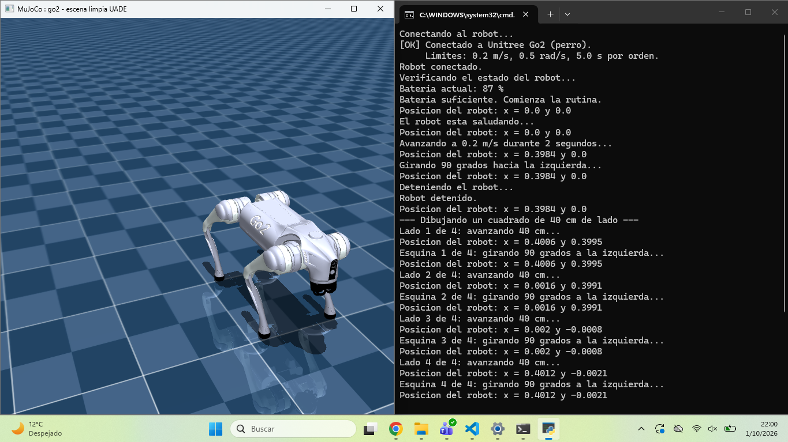
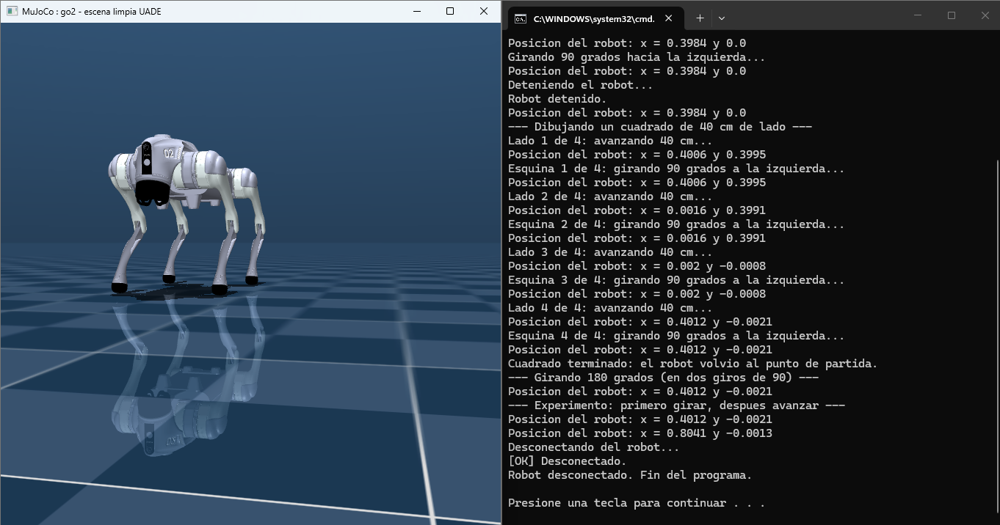

# Control de un robot Go2 en simulador

# Control de un robot Go2 en simulador

> **Sobre este repositorio:** subo este proyecto para compartir mi trabajo universitario no para que se pueda reproducir. El simulador, la clase `Robot` y los binarios que usa el programa son material de la materia: no me pertenecen y por eso no están incluidos. Sin ellos, el código no se puede ejecutar por sí solo. Las secciones de requisitos y ejecución están como referencia de cómo lo corrí yo, no como una guía para replicarlo.

Programa en Python que controla un robot Unitree Go2 (perro) dentro de un simulador hecho con MuJoCo. El robot verifica su batería, saluda, avanza, gira y se detiene, mostrando por consola cada acción y su posición.






## Qué hace

1. Se conecta al robot.
2. Verifica la batería: si es menor al 20 %, muestra una advertencia y no mueve el robot.
3. Saluda.
4. Avanza 40 cm (0,2 m/s durante 2 s).
5. Gira 90° a la izquierda (0,5 rad/s durante 3,14 s).
6. Se detiene.
7. Se desconecta.

Después de la rutina básica hace tres ejercicios extra:

- Dibuja un cuadrado de 40 cm de lado (cuatro veces: avanzar y girar 90°).
- Gira 180° partiendo el giro en dos órdenes de 90°.
- Invierte el orden (primero girar, después avanzar) para comparar dónde termina el robot.

Después de cada movimiento imprime la posición (`x`, `y`), así que leyendo solo la consola se puede reconstruir todo lo que hizo el programa.

## Capturas


## Cómo se calculan los movimientos

Las órdenes del robot reciben velocidad y tiempo, así que hay que calcular el tiempo necesario:

```
distancia = velocidad × tiempo
ángulo    = velocidad × tiempo      (en radianes)
```

- Avanzar: 0,2 m/s × 2 s = 0,4 m.
- Girar 90° (1,5708 rad) a 0,5 rad/s: 1,5708 ÷ 0,5 ≈ 3,14 s.
- Girar 180° necesitaría 6,28 s, que supera el máximo de 5 s por orden, por eso se hace con dos giros de 90°.

## Límites del robot

| Límite | Valor |
|---|---|
| Velocidad máxima de avance | 0,20 m/s |
| Velocidad máxima de giro | 0,50 rad/s |
| Tiempo máximo por orden | 5 s |

Si se pide un valor mayor, el programa se detiene y avisa cuál está fuera de rango. No lo corrige solo a propósito: si el robot fuera más lento sin avisar, recorrería menos de lo calculado y no se sabría por qué.

## Requisitos

- Python 3.10 o más nuevo.
- [MuJoCo](https://mujoco.org/) (siguiendo las instrucciones de instalación del simulador).
- El simulador provisto en la materia, que **no está incluido en este repositorio**.
- En Windows: Microsoft Visual C++ Redistributable (x64).

## Cómo ejecutarlo

1. Descomprimí la carpeta del simulador e instalá las dependencias.
2. Hacé doble clic en `INICIAR_SIMULADOR` (`.bat` en Windows, `.sh` en Mac/Linux) y elegí **2** (Go2). Dejá esa ventana abierta.
3. Copiá `tp01_sartori_agustina.py` dentro de la carpeta `mi_desarrollo/` del simulador.
4. Ejecutalo desde una terminal, parada en esa carpeta:

   ```
   python tp01_sartori_agustina.py
   ```

Si la ventana 3D no se abre, el simulador sigue funcionando en modo texto y el programa corre igual.

## Cómo probar el caso de batería baja

En el simulador la batería siempre vale 87 %. Para probar la advertencia, agregá temporalmente esta línea justo después de leer el estado en `main()`:

```python
estado.bateria = 10
```

El programa tiene que mostrar la advertencia y terminar sin mover el robot. Después borrá la línea.

## Problemas comunes

**`FileNotFoundError: Could not find module ... mujoco.dll (or one of its dependencies)`**

Falta alguna librería de Visual C++. Para verificarlo, en PowerShell:

```powershell
Test-Path "C:\Windows\System32\vcruntime140.dll"
Test-Path "C:\Windows\System32\vcruntime140_1.dll"
Test-Path "C:\Windows\System32\msvcp140.dll"
```

`Test-Path` responde `True` o `False` según si el archivo existe. Si alguno da `False` (en mi caso fue `vcruntime140_1.dll`), instalá el [Visual C++ Redistributable x64](https://aka.ms/vs/17/release/vc_redist.x64.exe), cerrá y volvé a abrir PowerShell, y repetí los comandos hasta que den `True`.

**Windows bloquea la ejecución de MuJoCo**

La seguridad de Windows puede bloquear el programa. En mi caso se resolvió desde Configuración > Privacidad y seguridad > Seguridad de Windows > Control de aplicaciones y del navegador. Conviene probar primero con una excepción puntual y, si hace falta desactivar la protección, volver a activarla después.

**"No encuentro el simulador"**

Abrí `INICIAR_SIMULADOR`, esperá a que aparezca la ventana y recién ahí ejecutá el programa.

## Estructura

```
├── instrucciones.py   # programa principal
├── capturas/
│   ├── consola.png
│   └── simulador.png
├── README.md
└── .gitignore
```

## Créditos y licencias

- El simulador y la clase `Robot` pertenecen al material de la materia y no se incluyen aquí.
- MuJoCo y el modelo del robot tienen sus propias licencias: consultalas en sus sitios oficiales.
- El código de `instrucciones.py` es propio.